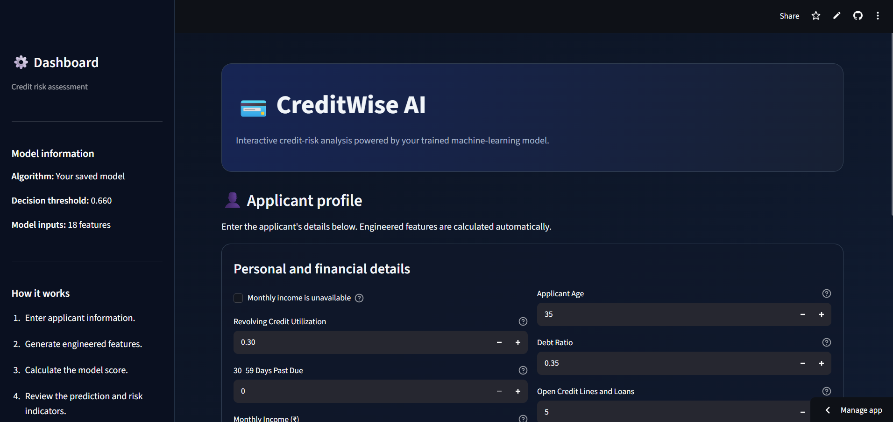
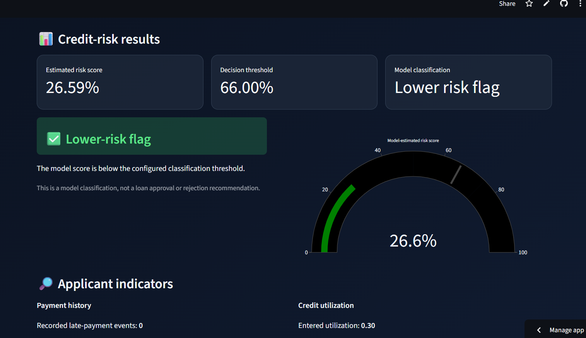

# 💳 Credit Scoring Model — CodeAlpha Internship

A machine learning project that estimates the likelihood of serious borrower delinquency using historical credit-related data. Developed as part of my **AI/ML internship at CodeAlpha**.

## 📌 Project Overview

Credit risk assessment is an important application of machine learning in financial services. This project explores how classification algorithms can learn patterns from historical borrower data to identify applicants who may be at higher risk of serious delinquency.

The project uses the **Give Me Some Credit** dataset from Kaggle, with `SeriousDlqin2yrs` as the target variable.

> **Disclaimer:** This is an educational machine learning project, not a validated credit underwriting system. Predictions should not be used as the sole basis for real financial decisions.

## ✨ Features

- Data preprocessing and missing-value handling
- Feature engineering for borrower-related indicators
- Comparison of Logistic Regression, Decision Tree, and Random Forest
- Evaluation using Precision, Recall, F1-score, and ROC-AUC
- Class-imbalance handling where appropriate
- Configurable prediction threshold
- Interactive Streamlit interface
- Visual presentation of model scores and predictions

## 🧰 Tech Stack

- **Language:** Python
- **Data processing:** pandas, NumPy
- **Machine learning:** scikit-learn
- **Visualization:** Plotly and Matplotlib, where used
- **Web interface:** Streamlit
- **Model persistence:** joblib

## 📂 Repository Structure

```text
CodeAlpha_CreditScoringModel/
├── app.py
├── credi_scoring.ipynb
├── requirements.txt
├── README.md
├── .gitignore
├── credit_model.joblib
├── Reports/
│   ├── roc_curves.png
│   └── feature_importance.png
└── screenshots/
    ├── app_home.png
    └── prediction_result.png
```

## 📊 Dataset

**Dataset:** Give Me Some Credit  
**Source:** Kaggle — https://www.kaggle.com/c/GiveMeSomeCredit

The target variable is `SeriousDlqin2yrs`, which indicates whether a borrower experienced serious delinquency within two years.

The dataset includes credit-utilization, age, debt-ratio, income, credit-line, late-payment, real-estate-loan, and dependent-count information.

Download the dataset from Kaggle and follow its terms of use. Place the training CSV in the location expected by your training script.

## ⚙️ Machine Learning Workflow

1. Load and inspect the dataset.
2. Separate the target variable from the input features.
3. Split the data into training, validation, and test sets.
4. Handle missing values and engineer features using transformations consistent between training and inference.
5. Train and compare Logistic Regression, Decision Tree, and Random Forest.
6. Evaluate each model on held-out data.
7. Select a model and classification threshold using validation data.
8. Save the fitted preprocessing pipeline and model.
9. Use Streamlit to collect applicant inputs and display predictions.

## 📏 Evaluation Metrics

The models are evaluated using:

- **Precision:** Of the borrowers flagged by the model, how many were positive cases?
- **Recall:** Of all positive cases, how many did the model identify?
- **F1-score:** Harmonic mean of precision and recall.
- **ROC-AUC:** How well the model ranks positive cases above negative cases across thresholds.

Because the target is imbalanced, accuracy alone is not sufficient. The decision threshold affects the balance between false positives and false negatives.

### Model Comparison

Add the verified metrics from your held-out test set below. Do not use training-set scores as if they were test results.

| Model | Precision | Recall | F1-score | ROC-AUC |
|---|---:|---:|---:|---:|
| Logistic Regression | 0.218 | 0.760 | 0.339 | 0.861 |
| Decision Tree | 0.189 | 0.809 | 0.306 | 0.854 |
| Random Forest | 0.291 | 0.668 | 0.405 | 0.864 |

## 🚀 Installation

### 1. Clone the repository

```bash
git clone https://github.com/YOUR_USERNAME/CodeAlpha_CreditScoringModel.git
cd CodeAlpha_CreditScoringModel
```

### 2. Create a virtual environment (recommended)

```bash
python -m venv .venv
```

Activate it on Windows:

```bash
.venv\Scripts\activate
```

On macOS/Linux:

```bash
source .venv/bin/activate
```

### 3. Install dependencies

```bash
python -m pip install -r requirements.txt
```

### 4. Train the model

If your training script uses the downloaded dataset:

```bash
python train_model.py
```

Confirm that the trained artifact is saved to the path expected by `app.py`.

### 5. Launch the application

```bash
python -m streamlit run app.py
```

The local Streamlit URL will appear in your terminal.

## 🖥️ Application Screenshots

Add screenshots of the actual running application here.

**Home screen**



**Prediction screen**



## 🔒 Responsible Use and Limitations

- Model scores are estimates, not guarantees of future borrower behavior.
- Class imbalance and the choice of threshold affect prediction errors.
- Historical financial data can contain biases and may not represent future applicants.
- Data quality, feature definitions, and preprocessing consistency are essential.
- The model has not been established as compliant with financial regulations or validated for real lending decisions.

## 🎯 Learning Outcomes

Through this project, I practised data preprocessing, feature engineering, classification, model comparison, evaluation under class imbalance, model persistence, and deployment of an interactive machine learning application.

## 👨‍💻 Author

**Yash Rajan**

- GitHub: https://github.com/yashrajan-ai
- LinkedIn: www.linkedin.com/in/yash-rajan1

## 🙏 Acknowledgment

Developed as part of the **CodeAlpha ML Internship**. Dataset credit belongs to the original Kaggle dataset contributors.

---

⭐ If you find this project useful, feel free to explore the code and share constructive feedback.
